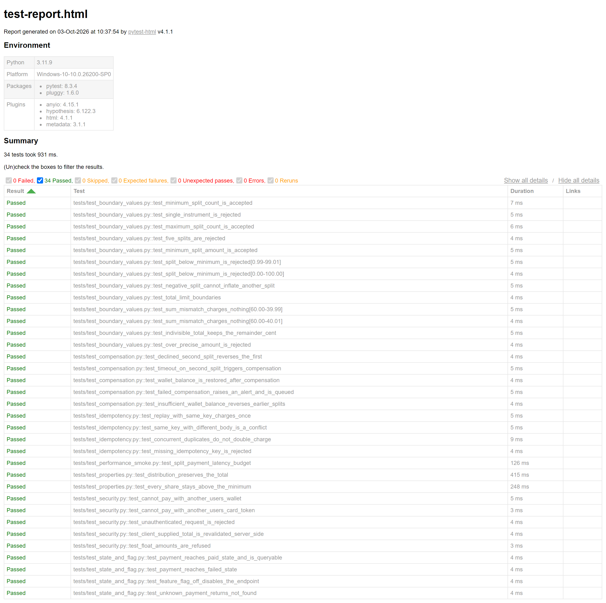
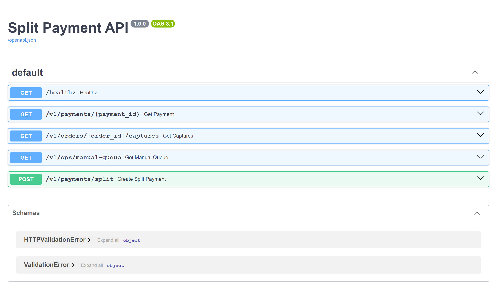
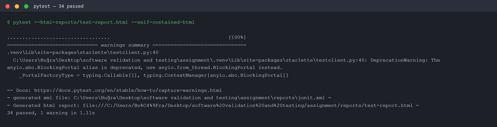
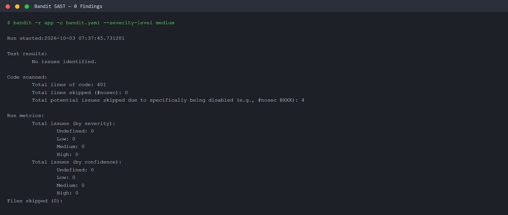
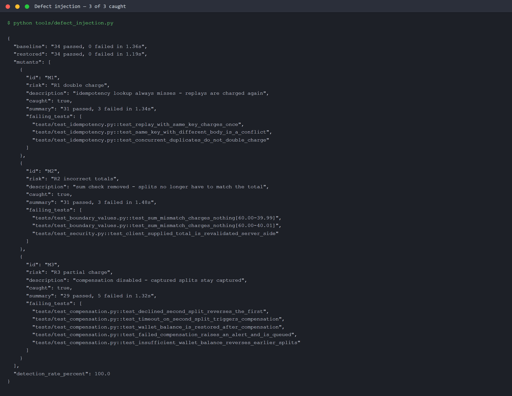

# Repository, Test Report and Evidence

## 1. Repository

**Repository:** https://github.com/REPLACE-ME/soft411-split-payment

> Replace the line above with the real URL once the repository is pushed, then rebuild
> this document with `tools/build_submission.py`. It is the only place in the submission
> where the URL appears.

Everything in this report can be reproduced from a clean checkout:

```bash
git clone <repository-url> && cd soft411-split-payment
python -m venv .venv
.venv/Scripts/python.exe -m pip install -r requirements.txt

.venv/Scripts/python.exe -m pytest --html=reports/test-report.html --self-contained-html
.venv/Scripts/python.exe -m bandit -r app -c bandit.yaml --severity-level medium
.venv/Scripts/python.exe tools/defect_injection.py
```

The same three commands are the three stages of the CI workflow, so a reviewer running
them locally sees exactly what the pipeline gates on.

## 2. Test execution summary

Recorded run — `reports/junit.xml`, 3 October 2026, Python 3.11.9 on Windows 10:

| Measurement | Result | Source artefact |
|---|---|---|
| Automated test cases executed | **34 passed, 0 failed, 0 skipped, 0 errors** | `reports/junit.xml`, `reports/test-report.html` |
| Suite wall-clock duration | 1.11 s (931 ms in tests) | `reports/pytest-console.txt` |
| Designed test cases | 23 (TC01–TC23), all automated | Test case design document |
| Test design techniques applied | 10 | Test case design document |
| Static security scan (Bandit) | **0 findings** at medium and high severity, 401 lines scanned | `reports/bandit.txt`, `reports/bandit-full.txt` |
| Abuse-case security tests | 5 passed | `reports/junit.xml` (`test_security.py`) |
| Performance smoke (p95 latency) | **0.77 ms** against a 15 ms budget, 200 requests | `reports/performance-smoke.json` |
| Defect injection (mutation-style) | **3 of 3 injected defects caught — 100 %** | `reports/defect-injection.json` |

Breakdown of the 34 executed cases by test file:

| Test file | Cases | What it covers |
|---|:-:|---|
| `test_boundary_values.py` | 13 | split count, amount and total boundaries, cent distribution |
| `test_compensation.py` | 5 | decline, timeout and insufficient-balance rollback paths |
| `test_idempotency.py` | 4 | replay, body-fingerprint conflict, concurrency, missing key |
| `test_security.py` | 5 | ownership, authentication, server-side revalidation, float refusal |
| `test_state_and_flag.py` | 4 | paid/failed state transitions, feature-flag rollback, 404 |
| `test_properties.py` | 2 | property-based invariants (500 generated examples) |
| `test_performance_smoke.py` | 1 | p95 latency budget |

## 3. Submitted artefacts

| Artefact | File | What it proves |
|---|---|---|
| HTML test report | `reports/test-report.html` | per-case results with durations and environment |
| JUnit XML | `reports/junit.xml` | machine-readable result totals, consumed by the CI summary |
| Bandit report | `reports/bandit.txt`, `reports/bandit-full.txt` | security scan at the gating severity and at every severity |
| Performance measurement | `reports/performance-smoke.json` | latency percentiles against a declared budget |
| Defect-injection result | `reports/defect-injection.json` | the suite fails when the application is broken |
| Console transcript | `reports/pytest-console.txt` | the raw run output behind the numbers above |
| Screenshots | `reports/screenshots/` | the figures below |

## 4. Screenshots



**Figure 1 — pytest HTML report.** All 34 cases Passed, 0 Failed. Test names are
readable, which is deliberate: each one states the rule it protects, so the report
doubles as a specification.



**Figure 2 — the system under test.** The generated OpenAPI surface: `POST
/v1/payments/split` plus the audit endpoints that make "no double charge" assertable
(`/v1/orders/{order_id}/captures`) and the manual-intervention queue used when
compensation itself fails.



**Figure 3 — test run console output.** `34 passed in 1.11 s`, with the JUnit and HTML
artefacts written in the same run.



**Figure 4 — Bandit static security scan.** No issues identified across 401 lines. The
four suppressed checks are documented and justified in the security triage section;
they are suppressions with reasons, not a silenced scanner.



**Figure 5 — defect injection.** Three defects were injected one at a time and the suite
re-run: broken idempotency, a removed sum check and disabled compensation. Each was
caught by the tests that own the corresponding risk, and the baseline was restored
afterwards. Detection rate 100 %.


**Figure 6 — CI/CD quality gate.** The GitHub Actions workflow executing on a push:
security scan, then the blocking functional suite, then the performance budget, with the
evidence uploaded as a build artefact.

## 5. How this evidence was produced

The figures are rendered from the committed artefacts rather than re-captured by hand
(`tools/make_screenshots.py`), so the report and `reports/` cannot drift apart; the
document itself is assembled by `tools/build_submission.py`. Figure 6 is the one
exception, as a workflow run only exists on the hosting platform.
